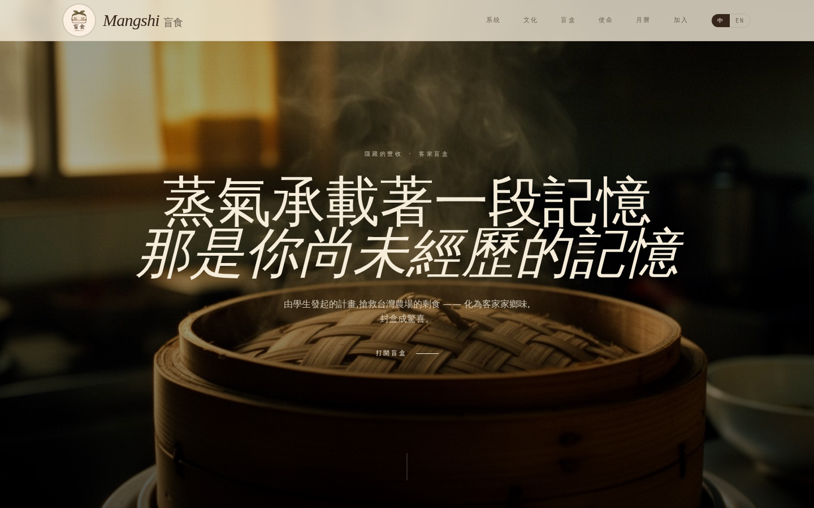
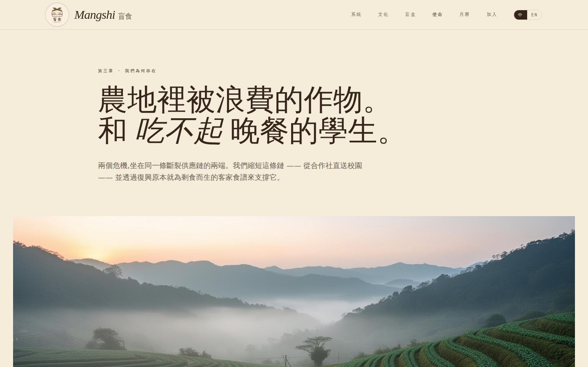

# Mangshi 盲食 — MERN Stack

**A student-led initiative rescuing surplus harvest from Taiwanese farms — served as sealed, blind Hakka heritage meals.**

Mangshi (盲食, "blind eating") is a Chinese-first, image-led site with a small operational system: farmers log surplus produce, campuses log meal preorders, and a deterministic matching engine turns that supply/demand snapshot into a kitchen production plan.

This version is built on the **MERN stack**: **M**ongoDB, **E**xpress, **R**eact, **N**ode.js.



## Tech stack

| Layer    | Technology                                                        |
| -------- | ----------------------------------------------------------------- |
| Database | **MongoDB** with **Mongoose** schemas and validation              |
| Backend  | **Node.js** + **Express** REST API (`server/`)                    |
| Frontend | **React 19** + Vite + React Router + TanStack Query + Tailwind CSS (`client/`) |

## Project structure

```
mangshi/
├── package.json            # root scripts: run client + server together
├── server/                 # Express + MongoDB API
│   ├── src/
│   │   ├── index.js        # entry point: connects to MongoDB, starts Express
│   │   ├── app.js          # Express app: middleware, routes, serves client/dist in production
│   │   ├── db.js           # Mongoose connection + JSON serialization (_id -> id)
│   │   ├── models/         # Recipe, FarmSupply, Preorder, SeasonalSurplus, JoinRequest
│   │   ├── routes/         # system, supply, preorders, recipes, seasons, join
│   │   └── middleware/     # error handling, admin key guard
│   └── seed/
│       ├── seed.js         # loads seed data into MongoDB
│       └── data/*.json     # recipes, seasonal calendar, demo supply + preorders
└── client/                 # React frontend (Vite)
    └── src/
        ├── main.tsx        # React root: Router, QueryClient, language provider
        ├── App.tsx         # route table
        ├── pages/          # one component per page
        ├── components/     # nav, footer, reveal animations, skeletons, error boundary
        └── lib/            # api.ts (fetch client), matching engine, i18n, translations
```

## Pages

**Public site** (Chinese-first, English toggle):
`/` Home · `/culture` Hakka food culture · `/box` the blind-box interaction · `/mission` the mission in numbers · `/seasons` month-by-month surplus calendar · `/join` sign-up form

**Operational system** at `/system`:
- `/system/supply` — farmers log surplus batches; campuses log preorders (full create / edit / delete)
- `/system/match` — scales the recipe library to available supply and confirmed orders
- `/system/kitchen` — the resulting production plan, with per-batch done tracking
- `/system/impact` — kg rescued, meals served, utilization and other totals
- `/system/recipes` — the read-only recipe library

## REST API

All endpoints are under `/api` and return JSON. Documents use a string `id`.

| Method | Endpoint               | Description                                              |
| ------ | ---------------------- | -------------------------------------------------------- |
| GET    | `/api/health`          | Server and database status                               |
| GET    | `/api/system`          | Supply, preorders and recipes in one snapshot            |
| GET    | `/api/supply`          | List surplus batches (newest 60)                         |
| POST   | `/api/supply`          | Log a batch `{ farmer_name, veg_key, name_zh, name_en, kg, available_from, available_to }` |
| PATCH  | `/api/supply/:id`      | Update a batch                                           |
| DELETE | `/api/supply/:id`      | Delete a batch                                           |
| GET    | `/api/preorders`       | List campus preorders                                    |
| POST   | `/api/preorders`       | Add a preorder `{ campus, portions }`                    |
| PATCH  | `/api/preorders/:id`   | Update a preorder                                        |
| DELETE | `/api/preorders/:id`   | Delete a preorder                                        |
| GET    | `/api/recipes`         | Recipe library (with embedded ingredients)               |
| GET    | `/api/recipes/:code`   | One recipe by code                                       |
| GET    | `/api/seasons`         | Seasonal surplus calendar + recipes                      |
| POST   | `/api/join`            | Submit the join form `{ name, email, role, note }`       |
| GET    | `/api/join`            | List join requests — **admin only**, send header `x-admin-key: <ADMIN_KEY>` |

Validation runs in the Mongoose schemas: invalid input returns `400 { "error": "..." }`, unknown ids return `404`.

## Getting started

**Requirements:** Node.js 20+ and MongoDB (a local install, or a free [MongoDB Atlas](https://www.mongodb.com/atlas) cluster).

1. Install dependencies for the root, server and client:
   ```bash
   npm run install:all
   ```
2. Create the server's environment file and set `MONGODB_URI` (the default points at a local MongoDB):
   ```bash
   cp server/.env.example server/.env
   ```
3. Load the recipe library, seasonal calendar and demo data into MongoDB:
   ```bash
   npm run seed
   ```
   (`npm run seed -- --keep` reloads only recipes and the calendar, keeping your supply and preorders.)
4. Start the API and the React dev server together:
   ```bash
   npm run dev
   ```
   Open http://localhost:5173. The API runs on http://localhost:5050, and Vite proxies `/api` requests to it.

> The API uses port **5050**, not 5000: on macOS, port 5000 is taken by the AirPlay Receiver.

### Environment variables (`server/.env`)

| Variable        | Default                               | Purpose                                   |
| --------------- | ------------------------------------- | ----------------------------------------- |
| `MONGODB_URI`   | `mongodb://127.0.0.1:27017/mangshi`   | MongoDB connection string                 |
| `API_PORT`      | `5050` (falls back to `PORT`)         | Port the Express server listens on        |
| `CLIENT_ORIGIN` | `http://localhost:5173`               | Allowed CORS origin(s), comma-separated   |
| `ADMIN_KEY`     | `change-me`                           | Secret for `GET /api/join`                |

## Production build

```bash
npm run build   # builds the React app into client/dist
npm start       # Express serves the API and the built React app on one port
```

To deploy to a single Node host (e.g. Render or Railway): set the build command to `npm run install:all && npm run build`, the start command to `npm start`, and set `MONGODB_URI` (an Atlas connection string) and `ADMIN_KEY` in the host's environment settings.

| | | |
|---|---|---|
|  |  |  |

## History

This project began as a TanStack Start + Supabase app deployed to Cloudflare Workers ([original](https://github.com/chiragjindal123/mangshi)). It was rebuilt on the MERN stack:

- Supabase (Postgres) → **MongoDB** with Mongoose models. Recipe ingredients are embedded in each recipe document instead of living in a separate table.
- TanStack Start server functions → an **Express REST API**.
- TanStack Router (SSR) → a **React** single-page app using React Router, with TanStack Query for data fetching.
- Edits and deletes on `/system/supply` now persist to the database. The old version kept them in browser localStorage when the database rejected them.
- The seed data was exported from the original database, so the recipes, seasonal calendar and demo snapshot match.

Known open items: the contact emails on `/join` and the footer's award and partnership copy are placeholder content. `/system` writes are not protected by a login.
