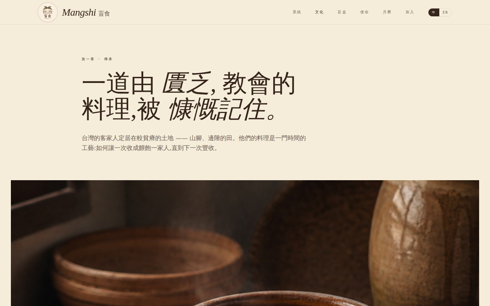
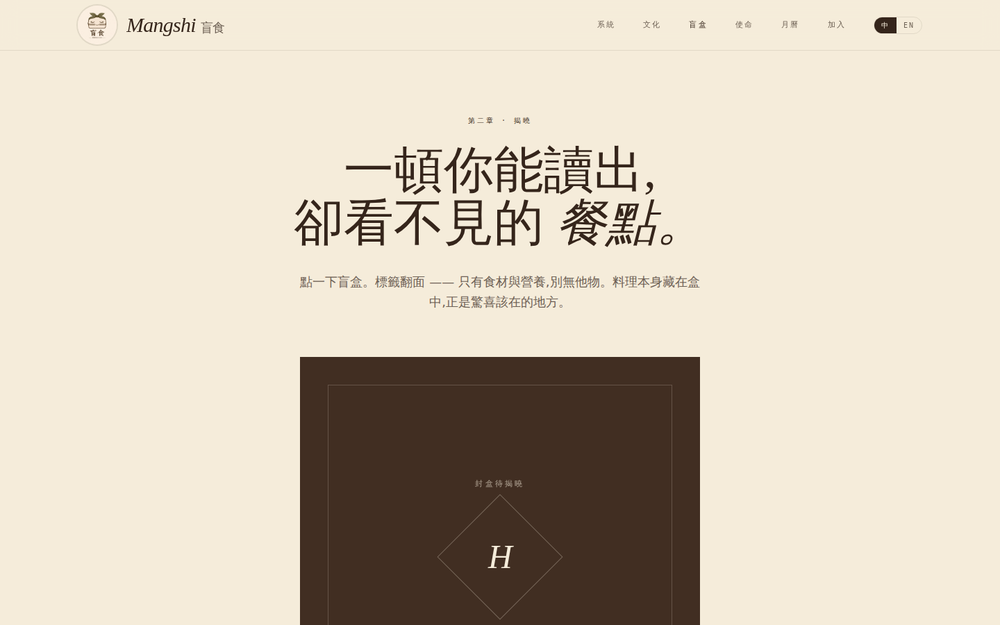

# Mangshi 盲食

**A student-led initiative rescuing surplus harvest from Taiwanese farms — served as sealed, blind Hakka heritage meals.**

Mangshi (盲食, "blind eating") pairs a Chinese-first, image-led marketing site with a small operational system: farmers log surplus produce, campuses log meal preorders, and a deterministic matching engine turns that supply/demand snapshot into a kitchen production plan — no invented recipes, nothing labeled AI, everything backed by a real Supabase database.


## What's here

**Public site** (Chinese-first, English toggle, image-led):
- `/` — Home
- `/culture` — Hakka food culture and preservation traditions
- `/box` — The blind-box interaction (flip a sealed card to reveal what's inside)
- `/mission` — The rescue-and-serve mission, in numbers
- `/seasons` — A month-by-month Taiwan surplus calendar mapped to recipes
- `/join` — Sign up as a student, farm, school, or volunteer

**Operational system** at `/system` (the part that makes this more than a landing page):
- `/system/supply` — farmers log surplus batches; campuses log preorders
- `/system/match` — a deterministic allocator scales the recipe library to available supply and confirmed orders (max utilization, subject to stock and kitchen-capacity limits)
- `/system/kitchen` — the resulting production plan, with per-batch done/not-done tracking
- `/system/impact` — kg rescued, meals served, utilization, and other running totals
- `/system/recipes` — the read-only validated recipe library the matcher draws from

| | | |
|---|---|---|
|  |  |  |

## Stack

- **Frontend**: React 19 + TanStack Start / Router, Vite, Tailwind CSS
- **Backend**: Supabase (Postgres + RLS), via `@supabase/supabase-js`
- **Deploy target**: Cloudflare Workers, via Wrangler + `@cloudflare/vite-plugin`
- **Data**: TanStack Query, with server-side rendering and SSR query hydration (`@tanstack/react-router-ssr-query`)

## Getting started

```bash
npm install
npm run dev
```

`.env` is checked in with this project's Supabase URL and *publishable* (anon) key — that's intentional, it's the public key meant to be client-visible, and Row Level Security is what actually protects the data. `npm run dev` works against that project out of the box. To point this at your own Supabase project instead, replace `SUPABASE_URL` / `SUPABASE_PUBLISHABLE_KEY` in both `.env` (covers local `vite dev`) and `wrangler.jsonc`'s `vars` block (covers the deployed Cloudflare Worker — the two are read independently, so both need updating) — and see **Database** below for the schema you'll need to recreate.

```bash
npm run build        # production build
npm run lint          # eslint
npx tsc --noEmit      # typecheck
npm run dev -- --host # local dev server
```

To deploy:

```bash
npm run build
npx wrangler deploy
```

## Database

Two migrations are checked in under `supabase/migrations/`:

- the nutrition-columns migration for `recipes` (protein/carbs/fat/fiber)
- `20260901031442_add_join_requests.sql` — creates the `join_requests` table (public INSERT via RLS, no public SELECT — submissions are read from the Supabase dashboard, which uses the service role)

The rest of the schema (`farm_supply`, `preorders`, `recipes`, `recipe_ingredients`, `seasonal_surplus`, plus two currently-unused tables — `production_plans` / `plan_items`, scaffolded for a future shared kitchen-plan feature) was provisioned directly against the Supabase project rather than captured as local migrations. **If you're standing this project up against a fresh Supabase project, you'll need to recreate that schema** — the full shape of every table (columns, types, nullability) is documented in `src/integrations/supabase/types.ts`, which is the source of truth to rebuild from.

**Run `20260901031442_add_join_requests.sql` against your Supabase project before the `/join` form will work** — either `supabase db push`, or paste the file into the SQL editor in the Supabase dashboard.

## Notes on this snapshot

This repo is a deployable snapshot of the [original project](https://github.com/chiragjindal123/mangshi) (built with [Lovable](https://lovable.dev)) after a debugging/audit pass: real TypeScript errors, a `/join` form that wasn't actually submitting anywhere, a missing Cloudflare Worker runtime config, a React hydration mismatch caused by the client and server query caches never being connected, and a handful of smaller UX fixes (wrong success-message copy, an inline delete confirmation, a consistent self-description across the site, loading states for data-fetched pages). See the commit history for the specifics.

Known open items:
- `/join` needs the `join_requests` migration applied to whichever Supabase project this is pointed at (see above).
- Contact emails on `/join` and the footer's award/partnership copy are placeholder content, not verified real details — update before treating this as production-ready.
- `production_plans` / `plan_items` exist in the schema but nothing in the app writes to them yet.
